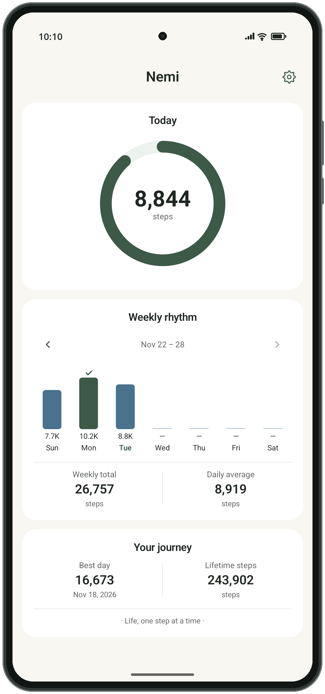
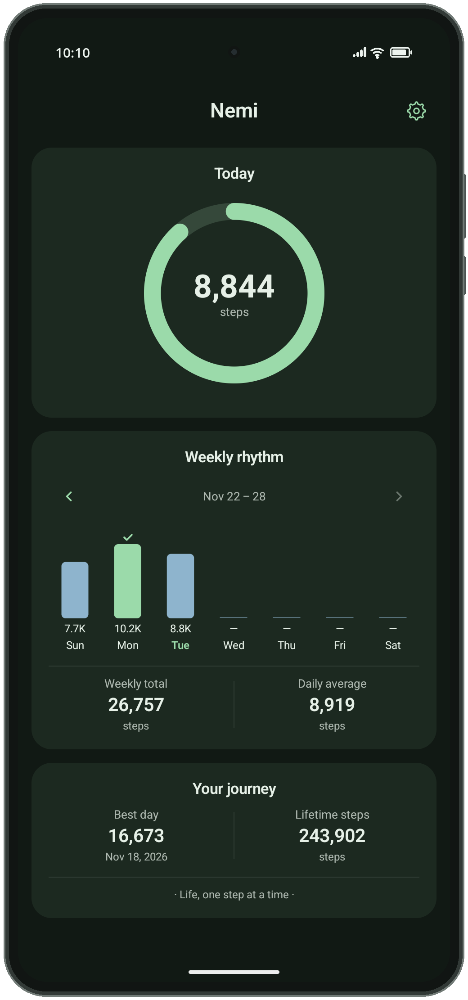

#  Nemi

Nemi is a ridiculously small Android step tracker powered by Health Connect.
Set a daily goal, see how much you walked this week, and keep your step history
on your phone.

Nemi is a personal app with three priorities, in this order.

1. Be useful for daily step tracking.
2. Look beautiful.
3. Be as lightweight as possible.

<p>
  
  
</p>

## What you can do

- Check today’s steps and your progress toward your daily goal.
- Browse past weeks and see your daily totals, weekly average, best day, and
  lifetime steps.
- Save a dated CSV backup or restore one from Settings.

## APK size

CI caps the unsigned release APK at **0.1 MB (100,000 bytes)**.

Nemi uses Java, Android framework Views, custom-drawn charts, and Android’s
built-in SQLite. The app ships without Kotlin, Jetpack Compose, AndroidX, or
other third-party runtime libraries. That saves space and means maintaining
the charts, activity lifecycle and result handling, and database access with
framework APIs.

## Device requirements

Nemi installs on Android 14 or later. Live phone steps require the system
Health Connect service, Android 14 (U) SDK Extension 20 or later, and a step
counter sensor. On GrapheneOS and other Android distributions, support depends
on the features shipped by the installed OS build. Nemi works independently of
Google Play Services and can display imported CSV history on devices without
native step tracking.

## How Nemi uses your data

In Settings, open Health Connect and tap **Allow steps access** to let Nemi read
steps recorded by your phone. Nemi stores daily totals on your device, leaves
Health Connect data untouched, and never transmits your health data. Imported
CSV totals fill in dates when Health Connect has no total.

## Why Nemi?

The name comes from classical Nahuatl.
[*Nemi*](https://nahuatl.wired-humanities.org/content/nemi) means “to live,
exist, or dwell,” and
[*nenemi*](https://nahuatl.wired-humanities.org/content/nenemi) means “to walk
or wander.”

## Build from source

Install a JDK that meets the minimum in [settings.gradle.kts](settings.gradle.kts)
and the Android platform set by `compileSdk` in [app/build.gradle.kts](app/build.gradle.kts).
Set `sdk.dir` in the repository’s `local.properties` to the path of your Android
SDK installation. Run this from the repository root:

```sh
./gradlew :app:assembleDebug
```

See [AGENTS.md](AGENTS.md) for verification and device deployment.
See the [release guide](docs/releasing.md) for release signing and publication.

## Acknowledgements

Nemi began as a fork of [Pedometer](https://github.com/j4velin/Pedometer),
originally created by Thomas Hoffmann.
